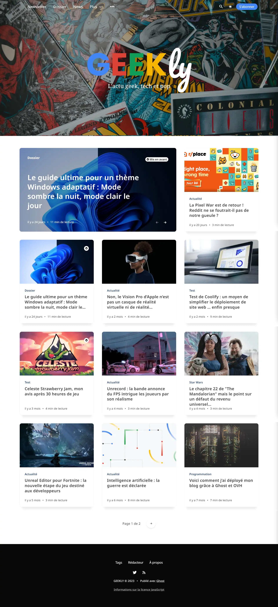

# Attibling

Attibling is a Ghost theme forked from [Liebling](https://github.com/eddiesigner/liebling) in which I added [Attila](https://github.com/zutrinken/attila)'s UI for the post part.

This theme was modified for the blog [GEEKLY](https://geekly.blog/) by [Alexis De Chiara](https://alexisdechiara.fr/) and is accessible for **free**, however, make sure you modify the elements presented in this README so as not to redirect to the blog.

## Features

### General features

✅ Clean and beautiful design
✅ Lightning fast
✅ Lightweight and high performance
✅ Fully responsive, looks great on any device
✅ Compatible with modern browsers

### Ghost features

✅ Subscription form
✅ Multiple authors
✅ Logo support
✅ Secondary menu
✅ Accent color
✅ Featured posts and pages
✅ Post, Page, Tag, Authors, pages
✅ Koenig editor
✅ Bookmark card
✅ Gallery card
✅ Button card
✅ NFT card
✅ Callouts
✅ Toggles
✅ Quotes
✅ Products
✅ Audio
✅ Video
✅ File uploads
✅ Headers
✅ Blog title and description
✅ Cover image for Home, Post, Page, Tag, Author pages
✅ Author avatar, bio, location, website and social links
✅ Social links for X, Facebook, LinkedIn, Bluesky, Threads, Mastodon, TikTok, YouTube and Instagram (site and authors)
✅ Native search (Ghost 6)
✅ Reading time
✅ Next and Previous post navigation
✅ Primary tag in posts

### Attibling unique features

✅ Ultrawide screen
✅ Dark mode
✅ Search
✅ Custom settings
✅ Custom Subscribe page
✅ Custom authors page
✅ Custom error page
✅ Medium style image zoom
✅ Comments with Disqus
✅ Share post on Facebook, X (Formerly Twitter), LinkedIn and by mail
✅ Slider for featured posts
✅ Support for normal, wide and full images in posts
✅ Reading progress indicator
✅ RTL language support

### Non-compatible features

🆗 Announcement bar (available but it is showed hover the navbar)

## Preview

## Download

To get the latest version please head over the [releases page](https://github.com/alexisdechiara/attibling/releases) and download the file `attibling.zip` of the latest release.

## Documentation

### Author guide (French)

[`docs/guide-auteur.md`](docs/guide-auteur.md) explains, feature by feature, what to do in Ghost Admin to make
each part of the theme appear: the theme settings (coloured wordmark, subscribe page, the tags of the home
rows), the internal tags (`#top`, `#top-1`…`#top-10` for « Les plus lus »), featured posts and the home hero,
the subscription block, the members-only features (bookmarks, « Reprendre la lecture ») and the navigation.

To know how to enable the search, comments, newsletter and more, please head to the [Liebling Wiki](https://github.com/eddiesigner/liebling/wiki).

## Localization

This theme has the same translations as the liebling themes with some additions of my own concerning the new features added.

* English
* Spanish
* German by [D3473R](https://github.com/D3473R)
* Informal german by [D3473R](https://github.com/D3473R)
* Bulgarian by [clappingmonkey](https://github.com/clappingmonkey)
* Vietnamese by [hiensarahly](https://github.com/hiensarahly)
* Italian by [vignini](https://github.com/vignini)
* French by [v1nc3nt-fr](https://github.com/v1nc3nt-fr) and [alexisdechiara](https://github.com/alexisdechiara)
* Informal french by [v1nc3nt-fr](https://github.com/v1nc3nt-fr) and [alexisdechiara](https://github.com/alexisdechiara)
* Portuguese by [ivomota](https://github.com/ivomota)
* Arabic by [allamiro](https://github.com/allamiro)
* Polish by [otlet](https://github.com/otlet)
* Brazilian portuguese by [pedrinholula](https://github.com/pedrinholula)
* Russian by [stereohorse](https://github.com/stereohorse)
* Kyrgyz by [januchaos](https://github.com/januchaos)
* Hebrew by [cohen604](https://github.com/cohen604)
* Turkish by [mskoroglu](https://github.com/mskoroglu)
* Romanian by [dsecareanu](https://github.com/dsecareanu)
* Chinese Simplified by [IvyB](https://github.com/IvyB)
* Indonesian by [iqbalbinsb](https://github.com/iqbalbinsb), [khannedy](https://github.com/khannedy)
* Lithuanian by [pintom](https://github.com/pintom)
* Dutch by [Qballjos](https://github.com/Qballjos)
* Traditional Chinese by [weixiang](https://github.com/weixiang)
* Persian (Farsi) by [Aminoiz](https://github.com/Aminoiz)
* Ukrainian by [partizan007](https://github.com/partizan007)
* Kazakh by [arshyn-t](https://github.com/arshyn-t)
* Korean by [chocosobo](https://github.com/chocosobo)
* Japanese by [ViaSnake](https://github.com/ViaSnake)
* Czech by [Fjuro](https://github.com/Fjuro)
* Swedish by [momeenme](https://github.com/momeenme)
* Slovak by [jjuris](https://github.com/jjuris)
* Thai by [Parinya T.](https://github.com/pickyzz)
* Croatian (from upstream Liebling)

## Requirements

Ghost 6.0 or later (the social links use the `{{social_url}}` helper, which Ghost 5.0 does not have).

## Credits

* [Liebling](https://github.com/eddiesigner/liebling) by Eduardo Gómez (MIT)
* [Attila](https://github.com/zutrinken/attila) by Peter Amende (MIT): post layout, and the X, Bluesky, Threads and Mastodon icons in `partials/icons/` (Copyright (c) 2015-2025 Peter Amende, MIT license)

## Help and support

If you have any questions or troubles with the Theme, please look at the [Liebling](https://github.com/eddiesigner/liebling/issues)'s and [Attila](https://github.com/zutrinken/attila/issues)'s issues first before opening an issue for [this repository](https://github.com/alexisdechiara/attibling).

## Live demo

You can see a live demo of the originals theme here:

* Liebling - [https://liebling.eduardogomez.io](https://liebling.eduardogomez.io)
* Attila - [https://attila.peteramende.de](https://attila.peteramende.de/)

## License

Copyright (c) 2023-present Alexis De Chiara. Released under the [MIT license](https://github.com/alexisdechiara/attibling/blob/master/LICENSE).
