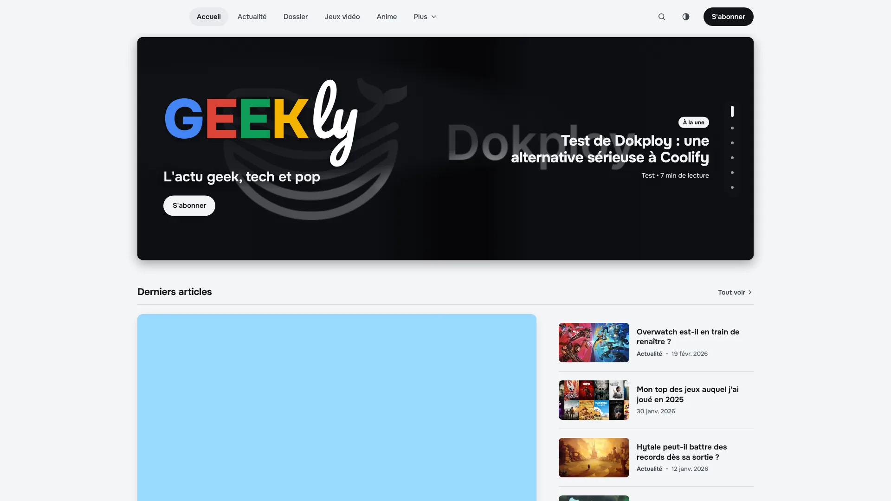

# Attibling

Attibling is a Ghost theme forked from [Liebling](https://github.com/eddiesigner/liebling) in which I added [Attila](https://github.com/zutrinken/attila)'s UI for the post part.

This theme was modified for the blog [GEEKLY](https://geekly.blog/) by [Alexis De Chiara](https://alexisdechiara.fr/) and is accessible for **free**, however, make sure you modify the elements presented in this README so as not to redirect to the blog.

## Features

Version 2 is a full redesign: a magazine layout in light and dark modes, built with native CSS (nesting,
`light-dark()`, container-friendly layouts) and small dependency-free ES modules (only `medium-zoom` and
`tocbot` remain). Everything works without settings and degrades gracefully: a browser lacking a feature
loses decoration, never content or navigation.

**Browser support**: Baseline Widely Available, i.e. Chrome and Edge 125, Firefox 126, Safari 17.5 (macOS and
iOS) and later. On those, every page is fully readable and usable; newer features (cross-page view
transitions, scroll-driven header, anchor-positioned menus, `@starting-style` fades, `text-box`, customizable
select…) are progressive enhancements. The build targets are set in `vite.config.mjs` (`browsers`, used for
both CSS and JS) and checked by `src/tests/browser-support.test.js`.

### Home page

✅ Hero card with the featured posts (pager, no autoplay) and the site's wordmark
✅ Optional coloured « GEEKly » wordmark (`use_geekly_logo`), drawn on arrival once per session (`arrival_animation`)
✅ The hero wordmark docks into the header as the page scrolls (scroll-driven animation, fade fallback)
✅ « Derniers articles », subscription block for visitors, « Continue reading / Read later » lists for members
✅ « Most read » row from the `#top` / `#top-1…10` internal tags, five rows by tag in varied forms (`home_row_1…5`)

### Posts

✅ Two styles, « Card » and « Immersive » (`article_style`, `#immersif` / `#carte` tags)
✅ Series from `#serie-…` tags, « In short » summary card, review card with Review structured data, `#mis-a-jour`
✅ Sticky table of contents, copy buttons on headings and code, reading progress, author box, related posts
✅ Members' display settings: four colour themes, fonts, width, size, line height, alignment, links, cover, style

### Pages and the rest

✅ Tag, author, all tags, all authors, archives (client-side filters, more than 100 posts), saved posts,
about, subscription and 404 templates
✅ Page transitions between pages (cross-document View Transitions, `page_transitions`) and prefetch on
hover / focus (Speculation Rules with a `<link rel="prefetch">` fallback, off with Save-Data)
✅ Ghost 6: native search, Portal, members, comments, custom fonts, announcement bar, every editor card
✅ Privacy: fonts served by the theme itself (no font service); YouTube / X / other embeds blocked by a
Content-Security-Policy until the reader agrees (`embed_consent`; YouTube in privacy-enhanced mode) — see
« Ce que le navigateur charge, et d'où » in the author guide
✅ Consent without a banner on arrival: the theme sets no cookie; each embed asks in its own place, « Accept
and show » covering all embeds (`consent_notice`: Notice by default, Banner, None); a small corner card or a
bar only for scripts you gate with `data-consent` (their hosts allowed by `consent_tools`, off by default); a
« Cookies et confidentialité » footer panel and page (slug `cookies`) show and clear what the browser holds;
Plausible opt-out; Google Consent Mode v2 when a Google tag is present — see
« Cookies et confidentialité » in the guide
✅ Accessibility: AA contrast, visible focus, 44 px targets, skip link, `prefers-reduced-motion` respected
✅ RTL languages; complete in English and French (formal and informal), 30 other locale files in part, the rest in English (see Localization)

## Preview

## Download

To get the latest version please head over the [releases page](https://github.com/alexisdechiara/attibling/releases) and download the file `attibling.zip` of the latest release.

## Documentation

### Author guide (French)

[`docs/guide-auteur.md`](docs/guide-auteur.md) starts with a ten-minute setup checklist, then explains, feature by feature, what to do in Ghost Admin to make
each part of the theme appear: the theme settings (coloured wordmark, subscribe page, the tags of the home
rows), the internal tags (`#top`, `#top-1`…`#top-10` for « Les plus lus »), featured posts and the home hero,
the subscription block, the members-only features (bookmarks, « Reprendre la lecture ») and the navigation.
For posts: the « Carte » / « Immersif » styles (`article_style` setting, `#immersif` / `#carte` tags), series
(`#serie-…` tags, `total: N` in the tag description), the « En bref » summary (an HTML card
`<ol class="en-bref">`, with an optional AI hook `data-source="ia"`), the review card (`<aside
class="fiche-test">`, Review structured data), `#mis-a-jour`, the author box and the members' display settings;
the arrival animation, page transitions and prefetch; and it ends with a reference of every setting and
convention and a troubleshooting table.

## Continuous integration

`.github/workflows/ci.yml` runs on every pull request and every push to a branch other than `master`/`main`.
Two jobs, in parallel, on Ubuntu with Node 22:

- **Check, build, assets, gscan**: `npm ci`, `npm run check` (format and lint), `npm run build`, then a check
  that the committed built files (`assets/` and `partials/tags/prepaint.hbs`) are exactly what the build
  produces, then `npm run zip` and gscan (pinned version, Ghost 6 rules) on the zip.
- **Browser tests**: `npm ci`, Chromium's headless shell through Playwright (cached per Playwright version),
  `npm test`.

A push to `master`/`main` runs `.github/workflows/deploy-theme.yml`: it calls the same CI workflow first and
uploads the theme to the site only if every check passes.

**When « Built assets are out of date » fails**: the theme is deployed as committed (Ghost does not build
it), so `assets/` must be rebuilt with every change to `src/`. Run `npm ci` (once) and `npm run build`, then
commit the changed files under `assets/` (and `partials/tags/prepaint.hbs` if it changed), usually as a last
commit « Rebuild theme assets », and push again. The job log lists the files that differ.

To run the same checks locally before pushing: `npm ci && npm run check && npm run build && git status
--short assets partials/tags` (must print nothing) `&& npm test && npm run zip && npx gscan@6.7.0 -z
attibling.zip --v6`, then delete `attibling.zip`.

## Localization

This theme has the same translations as the liebling themes with some additions of my own concerning the new features added.

Complete: `en`, `fr`, `fr-informal`. The 30 other locale files below translate only the strings inherited from
liebling (about 40 of 350); every newer string (series, reading settings, privacy, embeds…) is in English
there, so a site in one of those languages shows those parts in English. Contributions welcome.

* English
* Spanish
* German by [D3473R](https://github.com/D3473R)
* Informal german by [D3473R](https://github.com/D3473R)
* Bulgarian by [clappingmonkey](https://github.com/clappingmonkey)
* Vietnamese by [hiensarahly](https://github.com/hiensarahly)
* Italian by [vignini](https://github.com/vignini)
* French by [v1nc3nt-fr](https://github.com/v1nc3nt-fr) and [alexisdechiara](https://github.com/alexisdechiara)
* Informal french by [v1nc3nt-fr](https://github.com/v1nc3nt-fr) and [alexisdechiara](https://github.com/alexisdechiara)
* Portuguese by [ivomota](https://github.com/ivomota)
* Arabic by [allamiro](https://github.com/allamiro)
* Polish by [otlet](https://github.com/otlet)
* Brazilian portuguese by [pedrinholula](https://github.com/pedrinholula)
* Russian by [stereohorse](https://github.com/stereohorse)
* Kyrgyz by [januchaos](https://github.com/januchaos)
* Hebrew by [cohen604](https://github.com/cohen604)
* Turkish by [mskoroglu](https://github.com/mskoroglu)
* Romanian by [dsecareanu](https://github.com/dsecareanu)
* Chinese Simplified by [IvyB](https://github.com/IvyB)
* Indonesian by [iqbalbinsb](https://github.com/iqbalbinsb), [khannedy](https://github.com/khannedy)
* Lithuanian by [pintom](https://github.com/pintom)
* Dutch by [Qballjos](https://github.com/Qballjos)
* Traditional Chinese by [weixiang](https://github.com/weixiang)
* Persian (Farsi) by [Aminoiz](https://github.com/Aminoiz)
* Ukrainian by [partizan007](https://github.com/partizan007)
* Kazakh by [arshyn-t](https://github.com/arshyn-t)
* Korean by [chocosobo](https://github.com/chocosobo)
* Japanese by [ViaSnake](https://github.com/ViaSnake)
* Czech by [Fjuro](https://github.com/Fjuro)
* Swedish by [momeenme](https://github.com/momeenme)
* Slovak by [jjuris](https://github.com/jjuris)
* Thai by [Parinya T.](https://github.com/pickyzz)
* Croatian (from upstream Liebling)

## Requirements

Ghost 6.0 or later (the social links use the `{{social_url}}` helper, which Ghost 5.0 does not have).

## Credits

* [Liebling](https://github.com/eddiesigner/liebling) by Eduardo Gómez (MIT)
* [Attila](https://github.com/zutrinken/attila) by Peter Amende (MIT): post layout, and the X, Bluesky, Threads and Mastodon icons in `partials/icons/` (Copyright (c) 2015-2025 Peter Amende, MIT license)

## Help and support

If you have any questions or troubles with the Theme, please look at the [Liebling](https://github.com/eddiesigner/liebling/issues)'s and [Attila](https://github.com/zutrinken/attila/issues)'s issues first before opening an issue for [this repository](https://github.com/alexisdechiara/attibling).

## Live demo

You can see a live demo of the originals theme here:

* Liebling - [https://liebling.eduardogomez.io](https://liebling.eduardogomez.io)
* Attila - [https://attila.peteramende.de](https://attila.peteramende.de/)

## License

Copyright (c) 2023-present Alexis De Chiara. Released under the [MIT license](https://github.com/alexisdechiara/attibling/blob/master/LICENSE).
